  

  <b>Software Engineer, AI @ Microsoft</b> · <b>Founder, <a href="https://meeship.in">MeeShip</a></b> · <b>IIT Kanpur</b>
   
  I build AI products, by day for engineers and by night for Indian online sellers 🇮🇳

  <a href="https://meeship.in"><b>meeship.in</b></a> ·
  <a href="https://linkedin.com/in/iyashgoel"><b>LinkedIn</b></a> ·
  <a href="mailto:ygoel72@gmail.com"><b>Email</b></a> ·
  <a href="https://instagram.com/mee.ship"><b>@mee.ship</b></a>

---

## 🧭 What I do

**At Microsoft (IC3 AI Engineering).** I build AI systems for engineering teams: agents that fix broken pipelines, retrieval (RAG) over internal knowledge, an MCP server, and a platform for finding dead code.

**On my own: [MeeShip](https://meeship.in).** An AI tool for Meesho sellers. Meesho picks a product's shipping slab from how big the photo makes it look, so MeeShip regenerates the photo and sellers keep ₹25-50 more per order. I design, build, ship, market and support it myself: FastAPI backend, React frontend, payments, logs, SEO and Instagram.

**In e-commerce.** I have worked on the seller side too, so I build for problems I have seen first hand.

## 🛒 Inside MeeShip

| Tool | What it does |
|---|---|
| [**Image optimizer**](https://meeship.in/tools/meesho-image-generator) | Upload a product photo, get a version that lands in a lower shipping slab |
| [**Label crop**](https://meeship.in/tools/meesho-label-crop) | Free. Crops Meesho label PDFs in your browser and can include invoices |
| [**Profit calculator**](https://meeship.in/tools/meesho-profit-calculator) | Free. Works out real margin after commission, shipping and returns |
| [**All free tools**](https://meeship.in/tools) | Resizer, guides and more for sellers |

## 🧰 Stack

  
  
  
  
  
  
  
  
  
  
  

## ⛓️ Earlier chapter

Before AI products I worked in blockchain and smart contract security: a research internship at Nethermind, the National Blockchain Project, and [GameOfBlocks](https://github.com/yashgoel72/GameOfBlocks). I still think in threat models.

<i>Building in public. Say hi 👋</i>

